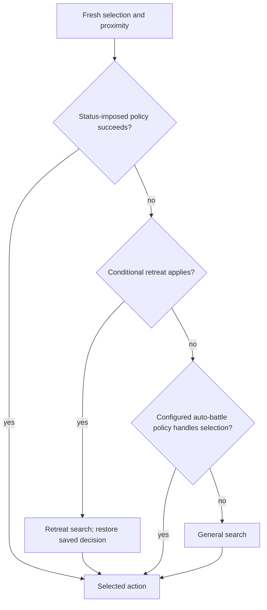

# Original FFT AI algorithm guide

ZOD-212, recorded 2026-10-29 from clean read-only fft_decomp
`11464943bbdbd2a0af022d90cb7f10455cf911df`; managed study base `04cd4d9`.
This is the central structural map of the algorithm available in that checkout.
It covers every policy selected by the top-level dispatcher and indexes every
function defined in the three core AI files. It is not an exhaustive numerical
transcription of all combat formulas, status rules, terrain routines or scripts.
Those dependencies remain explicitly identified below.

The [source index](../evidence/ai/algorithm-guide-v1.json) records file/function
fingerprints, chapter assignments, direct RNG sites and external entry points.
Line numbers in source links are conveniences at this fixed revision; symbols
and hashes identify the evidence. No original or C code is executed by this study.

## Reading the map

- **Implemented, bounded:** C# executes a source-traced subset with stated
  geometry, roster, ability, status and entry assumptions. This does not claim
  the whole source routine has been ported.
- **Mapped, unported:** control flow/responsibility is described from source;
  a general C# implementation and representative behavior vectors remain work.
- **Unresolved:** a compatibility interpretation or supporting behavior still
  needs evidence. Preserve it explicitly rather than substituting a guess.

In the notation below, **A** means
[abilities.c](https://github.com/adamrt/fft_decomp/blob/11464943bbdbd2a0af022d90cb7f10455cf911df/src/battle/ai/abilities.c),
**T** means
[turn.c](https://github.com/adamrt/fft_decomp/blob/11464943bbdbd2a0af022d90cb7f10455cf911df/src/battle/ai/turn.c),
and **E** means
[evaluation.c](https://github.com/adamrt/fft_decomp/blob/11464943bbdbd2a0af022d90cb7f10455cf911df/src/battle/ai/evaluation.c).
Use the chapter index at the end to locate smaller helpers. The
[completion roadmap](../development/ai-completion-roadmap.md) owns remaining
work areas; the [backlog](../BACKLOG.md) owns implementation order.

## 1. Lifetime and one-command boundary

Input is battle state, content/equipment/learned abilities, configured behavior,
retained AI workspace, current turn choices and the shared RNG stream. Output is
one MOVE, ACT or END command, or a suspended computation to resume later. A full
turn may require several commands and more than one fresh decision.

`A::ai_workspace_init` assigns compact records, initializes present units and
hardcoded Blood Suck/Frog Attack entries, map dimensions, average max HP and known
trap storage. `A::ai_unit_abilities_init` builds each unit's usable-list candidates,
weapon summaries, MP/Silence/evasion statistics and initial targeting/auto-battle
policy. List initialization and current usability are different stages. Learned
skills, monster/Frog entries, equipment and inventory feed the list builders.

The runtime controller enters AI command processing and calls `T::ai_command_build`.
Its fresh path is structurally:

```text
if scanline budget exhausted: suspend
if resuming: continue the saved phase without restarting prior work
if a decided action's saved Move/ACT choices equal current choices: END
if required compact records are absent: END
initialize current actor context
if no action is decided OR ACT is already used:
    enter AI simulation mode
    refresh flags and hypothetical timing
    prepare ability usability, usage policies and reach summaries
    build reachable movement tiles
    update team support and target policy
    choose an action through the policy tree in section 3
    mark selection decided; restore execution mode
dispatch one MOVE, ACT or END from the selection and current choices
save pre-command choices and shift command history
```

Source: `T::ai_command_build`, `acting_unit_init`, and controller
`ai_command_enter` / `battle_state_ai_command_update`. Initialization is broader
than the current port. Command authority is **implemented, bounded** through
[Framework transactions](ai-command-boundary.md); original incremental-frame
suspension and all controller paths remain **mapped, unported**.

## 2. Fresh preparation and target policy

`T::decision_flags_refresh` consumes current units, teams, statuses and cached
policy values, then runs a skillset-zero simulation to derive transient flags.
It restores simulated units while retaining relevant decision facts and RNG.
An ACT-used actor is not converted into an ACT-unused snapshot.

`T::ability_considerations_set` first rebuilds usable entries and harmful/helpful
and ranged/healing summaries for present eligible units. Restrictions include
Frog, Don't Act, Silence/Innocent at resolution time, costs and ability-specific
conditions. Its actor-only second pass refines usage/status-cancel policies and
minimum ally/enemy reach, then clears actor usability if ACT is already used.
Do not erase reach or first-pass summaries after that clear.

`T::reachable_tiles_build` obtains actual movement reachability. Team policy
counts eligible allies/enemies and impaired allies. With too few available
allies, or all allies impaired, retreat support is unavailable; non-player teams
also retain/update their support-unavailable policy. Death Sentence and prior
policy flags affect this path.

`T::decision_target_consideration_init` preserves applicable configured behavior
or selects policy/focus. Player-controlled units can retain their auto-battle
setting. Ordinary player-team units below the source HP ratio threshold seek a
healer/crystal; otherwise they seek an eligible enemy. Other teams choose manual
enemy focus or fading-life behavior according to support flags. Target search
has mode-specific eligibility and slot-order ties; no match can default to the
actor. Never generalize one nearest-enemy filter to all target searches.

**Implemented, bounded:** shared refresh and restored-state preparation for two
ordinary living opponents; Attack-only moved/unmoved/post-ACT entries and fresh
pre-ACT and [post-ACT Attack/Throw Stone preparation](../behavior/attack-throw-stone-ai-post-act-preparation.md).
See [refresh](zod-156-ai-refresh-prefix.md),
[pair preparation](zod-195-pair-preparation.md) and [post-ACT pair study](zod-209-pair-post-act.md).
Full list construction, teams, status timing and special policies are **mapped,
unported**; pair post-ACT command execution remains the next implementation child.

## 3. Policy precedence

Fresh `T::action_select` resets rank fields/defaults of ranked/current/best/
baseline/selected records, retaining other payload, then fills foe proximity.
It chooses the first applicable path in this order:



Any child may suspend; `-1` preserves the corresponding stage for resumption.
Conditional retreat means `(Frog or Critical) and retreat support available`,
or `Don't Act and focused target`. It temporarily saves/restores the actor's
decision record. This condition precedes configured auto-battle dispatch.

### 3a. Status-imposed behavior

`T::status_imposed_select` checks **Chicken → Blood Suck → Confusion → Berserk**.

- Chicken scores movement, clears target distances, chooses a destination and
  returns movement only.
- Blood Suck selects the nearest unit without Blood Suck and loads its hardcoded
  action. It tries random legal action selection; failure approaches the target.
- Confusion builds eligible targets, chooses usable abilities randomly without
  replacement, and tries random legal actions. Failure approaches the nearest unit.
- Berserk chooses the nearest enemy and uses Attack for an ordinary non-Frog
  human, otherwise the hardcoded Frog Attack; failure approaches that target.

`T::random_select` is not the scored search: it samples ability/Math combinations,
origins, targeting type and aim tiles as applicable. Rejected tiles and retained
counts follow their source update order. These policies are **mapped, unported**.

### 3b. Configured auto-battle behavior

`T::autobattle_select` dispatches source enum values; names below are source
identifiers, not a proposed UI or an inferred universally optimal strategy.

- **FIGHT_FOR_LIFE / targeted:** `fight_for_life_select` repairs an invalid focus
  (including mount/Transparent cases), scores movement and builds targeted
  scenarios. After a charging check, it evaluates the designated target first,
  then any unit, trying ranked selection after each pass; fallback uses scenario 2.
- **PROTECT_ALLIES / recovery:** `protect_allies_select` can retarget an ally in
  peril. It tries status cancellation in Dead, Petrify, Blood Suck order, with
  Reraise handling and one target-selection retry. It then checks charging,
  designated-target abilities, enemies, and allies in that order, with ranked
  selection between passes, then scenario 2 fallback.
- **FADING_LIFE:** `save_fading_life_select` switches to recovery when an ally is
  in peril and returns `-2` to chain into that policy; otherwise it focuses its
  configured target and runs general search.
- **RETREAT:** `retreat_select` focuses the nearest healer/crystal and builds a
  retreat movement baseline. It tries self-target abilities and ranked selection,
  then keeping a charge. It disables Charge-skillset entries before an any-unit
  ability pass and final fallback.
- Other settings fall through to general search.

The dispatcher also contains recovery `-2` → retreat chaining, but
`protect_allies_select` never returns `-2` at this revision. Preserve that
distinction rather than describing the syntactic branch as a reachable behavior.

Supporting helpers include `targeted_build`, `retreat_build`,
`target_in_peril_select` and `status_cancellation_evaluate`. Peril selection uses
status priority, distance, missing HP and team importance with source-specific
packing/ties; cancellation excludes innate statuses and uses the actor's aggregate
cancellation mask. The Blood Suck cancellation branch tests transient Jump,
a documented retail quirk. These policies are **mapped, unported**; their complete
arithmetic/status/content regressions are not yet established in C#.

## 4. General search and movement scenarios

`T::general_select` builds movement scenarios once, seeds the move-only baseline,
checks whether to retain a charge, selects active targets, evaluates the ability
list, runs ranked selection and uses fallback when no ranked entry is chosen.
It does not rebuild preparation and movement for every ability.

`T::scenarios_build` derives target distances and reach, scores the source-selected
movement mask, and chooses D1. In-reach and out-of-reach paths differ: out-of-reach
filters toward the target before scoring, then non-player teams halve reach one
time in seven before destination selection. Stay-near/reflected behavior and
crystal distances have separate conditions. Scenario 2 is constructed as the
complement before insertion of the actor into scenario 1.

When ACT is unused and the focused target is in reach, D0 can use the closer
distance-bound search, relaxed to at least 3 by ranged ability against an enemy.
Otherwise D0 copies D1. Post-ACT does not reuse pre-ACT D1. Destination ordering,
distance fallbacks, foe proximity and coordinate ties are source-specific.

`T::keep_charging_select` handles no charge, Song/Dance, and ordinary charging
separately. The ordinary path simulates retaining versus clearing the charge,
restores saved charge/status state, and compares ranks. It can suspend between
those phases. This is not a blanket instruction to cancel or preserve charges.

**Implemented, bounded:** ordinary flat movement/scoring and explicit reach
branches, including the two-family pre-ACT pair and
[post-ACT pair scenarios](../behavior/attack-throw-stone-ai-post-act-scenarios.md).
Charging, terrain breadth and
special scenario overrides remain **mapped, unported**. Unknown original-origin
priority values and retained/event alias history remain **unresolved** where
actually read; see [out-of-reach provenance](zod-199-pair-out-of-reach.md).

## 5. Ability, origin and target evaluation

`T::target_active_units_select` builds policy-specific active targets; ANY,
ENEMIES, ALLIES, SPECIFIC and STATUS are distinct filters. `T::ability_list_evaluate`
walks entries in source order until the NONE terminator or original list bound.
Resume continues the same outcome evaluation without reloading/advancing the entry.
`T::ai_ability_entry_load` derives considered flags, range/area, CT, costs, element
and effects from weapon/ability/item/Math data and current usage bits.

`E::ai_ability_outcome_evaluate` performs these ordered branches:

1. Suspend if needed; skip unusable abilities; apply the random-use gate.
2. Initialize the current action and targetability. Map-wide abilities either
   enter Math evaluation or usefulness filtering and move/ACT ordering evaluation.
3. For ordinary targeting, consider reflected alternatives first, filter useful
   targets, then consider self-target alternatives.
4. Follow-target abilities evaluate unit targets. Some split targets into
   complementary CT/movement-opportunity groups and restore eligibility afterward.
5. Remaining area/tile alternatives exclude relevant enemies that can move before
   resolution and evaluate tile targets. Insert the best action into ranked slots.

`E::ai_target_classify_ability_effect` is a timing-aware usefulness heuristic:
side restrictions, caster exclusion, Reflect/Innocent/Jump, death/revival,
statuses, resources, effects and special ability cases matter. It is not simply
"damage to enemies is useful". Healing, status cancellation and effect categories
must eventually be mapped to the corresponding actual gameplay rules.

`E::ai_cast_aim_tiles_build` constructs cast-origin and aim masks using range,
area, trajectory, water, Geomancy terrain and Monster Skill conditions.
`origin_reachable_evaluate` selects exhaustive versus ranked-origin scans; the
non-exhaustive path forces ranked scanning even after its product threshold test.
`origin_next_take` uses signed priority/proximity keys and later-coordinate ties.
`origin_destination_finalize` distinguishes ACT-before-Move from Move-before-ACT.
`origin_aim_tiles_evaluate` applies actual range/trajectory/height/target rules,
with source aim-consumption ordering. Reflection, self targeting and Math have
their own helpers rather than one uniform origin×target loop.

**Implemented, bounded:** ordinary sword and Throw Stone projections/scans, their
shared prefix and pair ranking. Full roster/list traversal, other ability effects,
Math, reflection, delayed area targeting and complex maps remain **mapped, unported**.
The [iteration study](zod-185-ai-ability-iteration.md) and
[Throw Stone scan study](zod-190-throw-stone-ai-scan.md) provide detailed subset traces.

## 6. Candidate simulation and absolute score

`E::ai_action_evaluate` simulates/scores and retains an improving best action.
`ai_action_simulate_and_score` saves selected baseline fields, applies movement
and action in candidate order, then ends the actor's hypothetical turn. Immediate
actions hitting nothing can reject a candidate; Defend and skillset-zero have
separate handling. Pickups and movement choice flags affect the result.

It advances the actual turn-clock machinery, applying pending results and ready
charged actions, recording movement opportunities, until no charge/performance
remains or the source event limit is reached. A refresh-only pass writes transient
decision flags instead of a scored rank. A scoring pass evaluates each compact unit:

- HP share scaled by 128, plus status table weights and special status interactions.
- Kept non-monster equipment, 51 per unchanged slot relative to baseline.
- MP share scaled by 64, discounted below the cheapest paid ability and weighted by
  the unit's MP-ability modifier.
- Team Golem share scaled by 128 using average present max HP, with an extra loss penalty.
- Enemy contributions negated; summed priority uses the source arithmetic widths.

Status weights are conditional: e.g. Darkness/Silence use initialization modifiers,
control-changing statuses alter positive-status credit, and disabling effects
interact with those control states. Throwing non-shuriken/non-ball weapons halves
the candidate hit percentage afterward. These details preclude treating the
algorithm as selecting maximum immediate damage or maximum expected damage.

Simulation restores selected unit/action/team/clock state, not the whole workspace
or RNG. `simulation_unit_state_save/restore` distinguishes baseline and suspended
simulation snapshots. Helpers simulate strikes/reactions and classify timing.
**Implemented, bounded:** shared clocks and absolute scoring under restricted
profiles. Full status weights, charge/reaction resolution and pickup effects remain
**mapped, unported**; combat formulas/terrain dependencies need separate rule coverage.

## 7. Rank admission, lottery and fallback

`T::rank_compare` compares decided marker, signed 16-bit priority, then byte hit percent.
`ai_rank_is_higher` adds lower foe proximity on otherwise equal ranks; a complete
tie is not an improvement. `ai_best_rank_insert` requires beating the move-only
baseline using the rank comparison and the last ranked entry using the stronger
comparison, then inserts/shifts and resets best rank fields. Preserve these
different comparison boundaries and retained payload.

`ranked_select` visits the original eight slots in order. Each visited slot draws
`rand()%100`, including hit-zero slots. First success wins. If every roll fails but
some hit was nonzero, slot 0 wins; if all hits were zero, it reports no selection.
This is not a normalized weighted lottery. `fallback_select` chooses the scenario
destination with move-first and either Defend or skillset zero according to support.

**Implemented, bounded:** shared ranking/lottery, ordinary/pair admission and
explicit no-Defend fallback, including [pair post-ACT selection](../behavior/attack-throw-stone-ai-post-act-selection.md).
General policy-specific multi-pass rankings and full
Defend support remain **mapped, unported**. Original eight slots are compatibility
behavior, not a proposed custom-content capacity.

## 8. Actual command, remaining choices and facing

After fresh selection restores execution mode, `T::ai_command_build` emits MOVE
when Move is unused, ACT is used or the plan is move-first, and destination differs.
Otherwise ACT-used or empty skillset emits END; otherwise it emits ACT. It saves
current pre-command choices. A normal Move-first step retains the chosen ACT;
ACT-first causes fresh selection on re-entry from actual results.

The controller applies real movement/actions and eventually Wait/facing. Prediction
is not actual damage, displacement or completion. `E::ai_wait_facing_choose` uses
a stored hint or evaluates viable adjacent headings and nearest imminent/enemy
directions, falling back to current/last viable facing. An overlap direction can
read beyond the four-byte viability array; its retail value remains **unresolved**.

**Implemented, bounded:** Framework-owned real commands, RNG adoption, exact-state
continuations and completion/facing receipts; Attack-only post-ACT settlement.
Pair post-ACT execution, terminal battle routing and full host activation remain
work. See [command boundary](ai-command-boundary.md) and
[pair post-ACT flow](zod-209-pair-post-act.md). The source's incremental frame
suspension is not a save-file feature or a managed command authority mechanism.

## 9. RNG, suspended work and observable quirks

All paths share BIOS RNG in the original. Restoring a hypothetical candidate does
not rewind its draws. `combat/outcomes.c::formula_get_random` supplies midpoint
0x4000 in AI/preview mode, but that does not make the whole search non-random.
Direct `rand()` sites in the three core files are indexed in the receipt:

- `T::scenarios_build`: non-player out-of-reach reach adjustment.
- `T::ranked_select`: one roll per visited ranked slot.
- `T::status_imposed_select`: Confusion's ability order.
- `T::random_select`: random Math choices and follow-target targeting type.
- `T::random_tile_take`: random tile selection.
- `E::ai_ability_outcome_evaluate`: random-use admission.
- `E::ai_target_classify_ability_effect`: Praise/Accumulate/Yell usefulness coin.

Indirect calls add formula-specific evasion, turn/upkeep, status/reaction and
actual-resolution draws. Some are skipped or replaced in simulation; costs are
branch-dependent. `turn.c`/`evaluation.c` contain scanline checks and many saved
resume phases. Resume must not restart completed prefixes or discard retained
data. The original VSync callback also advances BIOS RNG; exact frame-interleaved
stream equivalence remains unresolved. Managed rendering/pauses consume no gameplay
draws. See [RNG study](zod-154-ai-execution-rng.md).

Other pinned source quirks include Monster Skill/Defend bits used for CT reduction,
the Blood Suck/Jump cancellation test, unsigned negative Monster Skill neighbor
offsets and large-radius mask-table overreads. Refer to pinned
[QUIRKS.md](https://github.com/adamrt/fft_decomp/blob/11464943bbdbd2a0af022d90cb7f10455cf911df/QUIRKS.md).
Their existence is mapped; their full managed behavior is not inferred from that.
Retained/event workspace history and unknown original flags remain subject to
the existing evidence gates. Do not silently clean away observable quirks.

## 10. Source function index and external dependencies

The receipt assigns **all 105 function definitions** in A/T/E to a chapter above,
including memory utilities, geometry/mask helpers, timing/status tests and rank
comparators. It gives symbol, fixed-revision line range and body hash for each.
This is a completeness check on the structural inventory, not proof that every
formula or branch has a behavior oracle. The inventory is reproduced by the
guide verification command below; detailed studies remain independently linked.

Outside A/T/E, relevant boundaries include controller command routing and
`combat/outcomes.c` simulation-mode changes; `turn/clock.c` event progression,
upkeep and unused-choice refunds; action preparation/resolution and combat
formula modules; movement/path/range/trajectory/terrain routines; unit/status/
reaction helpers; imported content tables; and event/script changes to live state.
Those bodies are not all exhaustively mapped by this guide. The source index
pins selected external boundaries and the inherited studies cover narrower paths.

Original constants include 21 unit slots, 16 compact AI records, 34 list entries and
eight ranked actions. They explain original storage/guards and must not silently
become general managed content limits. Global workspace, targetability overlays,
partial resets and arithmetic widths remain compatibility concerns even when
managed objects replace their byte storage.

Use `verify_ai_algorithm_guide.py --reference C:/repositories/fft_decomp --output
<new scratch report>` to check the pinned inventory, chapter links, source-symbol
coverage and direct RNG sites. This is a source/document audit, not original/C
execution or a new AI oracle. The [handoff](../PROJECT_HANDOFF.md) records current
implementation validation; the original guide inventory reports remain in
ignored `scratch/ai-algorithm-guide-212/`.

The next implementation is ZOD-215 pair post-ACT command execution and settlement.
A future replaceable AI interface should consume explicit state/content/RNG and
return decisions checked by authoritative rules. Its concrete design must use
the supported domain and a real consumer, rather than exposing the entire
original workspace or prematurely committing to the current pilot's types.
