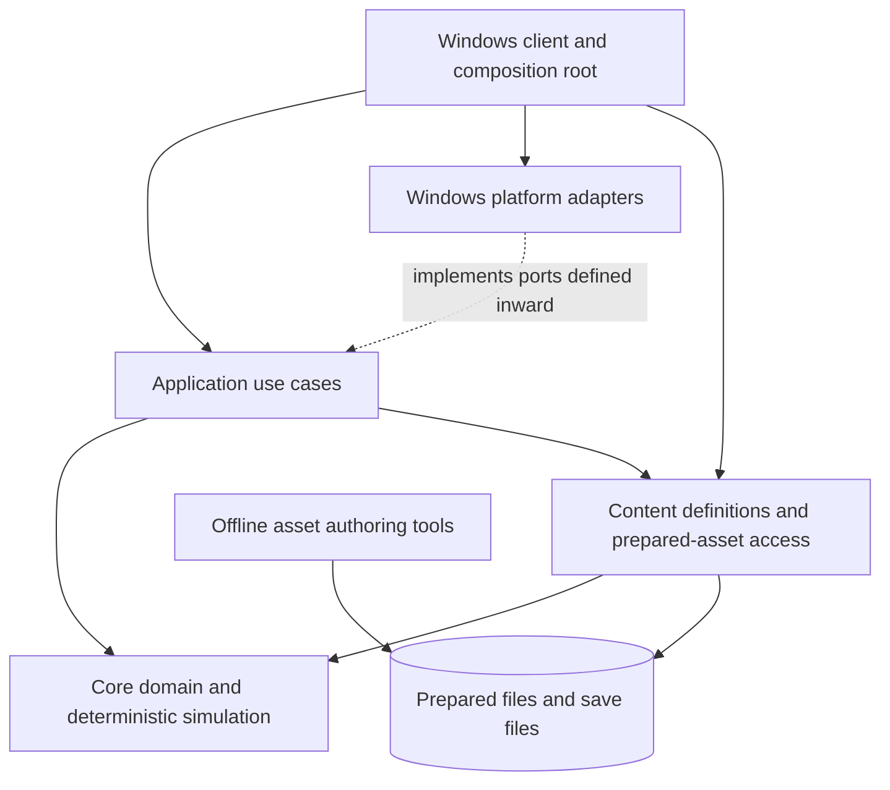

# Architecture overview

**Engine name:** Zodiac. Final Fantasy Tactics is the first planned content set. Existing solution, project, and namespace names remain `Fft.*` for now; renaming them is a separate compatibility/workflow decision.

**Status:** Proposed architecture for review. The repository is still an early prototype; the diagrams below describe intended dependency boundaries, not a claim that these projects or services already exist.

## Goals

- Reproduce the North American PS1 release (`SCUS-94221`) as a managed C#/.NET Windows application.
- Keep compatibility behavior observable and testable, including quirks that affect play.
- Keep the original simulation deterministic and independent of presentation and operating-system services.
- Permit additional content and mechanics without imposing the original executable's fixed-size data limits.
- Use the C decompilation and locally prepared game files as development references and import sources, never as runtime dependencies.

## Current repository, verified

- `Fft.Core` contains common identifiers/value types, map data types, a typed battle transition proof, and flat-grid movement policies (one prototype and one bounded terrain-cost slice).
- `Fft.Content` loads a versioned manifest and hash-verified loose files by logical asset ID. It references `Fft.Core`.
- `Fft.AssetTool` and `Fft.AssetTool.Cli` handle offline image inventory, extraction, and a narrow unit `.SPR` parsing/decoding proof. The CLI composes the tools.
- `Fft.Client` is a console composition proof. It can load a prepared asset; it is not yet an interactive game client.
- Tests exist for the current projects. No complete campaign runtime, graphics/audio backend, input loop, or save system exists yet.

The architecture should evolve from this shape without splitting projects just for conceptual neatness. Add a new assembly when it creates a useful dependency boundary or an independently testable responsibility.

## Target dependency shape

`Fft.Core` is the current home for the domain and simulation boundary. An `Fft.Application` project is a future option for client-facing use cases once those use cases exist; it should not be created only to add another layer around the current console command. Windows adapters and a rendering library are intentionally undecided.

The dependency rule is inward: simulation code must not reference `Fft.Client`, graphics/audio/input packages, operating-system APIs, the BIN, or the C reference. Platform adapters implement interfaces owned by an inward-facing layer. The client is the composition root that chooses implementations and connects input, use cases, content, and presentation.

## Responsibilities and contracts

### Core domain and simulation

- Own stable IDs, immutable content-facing definitions, battle/campaign runtime state, rule calculations, compatibility profiles, deterministic random state, and simulation events.
- Represent play as explicit inputs to a transition: current state plus a command and RNG state produce a new state, result/events, and updated RNG state.
- Avoid file I/O, wall-clock reads, global randomness, rendering, audio, and direct input polling.
- Use collections sized by content and explicit validation/resource budgets. Preserve original limits only when they affect compatibility or are an intentional safety limit.
- Record arithmetic width, rounding, RNG draw order, and update ordering where they affect observed behavior.

Commands express requested actions; the simulation validates them. Events describe accepted state changes for presentation, logs, and tests. They are not a second authority that can mutate simulation state. Start with simple typed C# models; do not introduce a generic ECS, event sourcing framework, or plugin bus until a concrete need appears.

### Content definitions and runtime state

- Keep immutable, validated definitions (jobs, abilities, items, maps, encounters, campaign data) separate from mutable instances (unit HP/MP, status, equipment, turn state, and story flags).
- Give definitions stable, namespaced IDs. Validate cross-references and schema versions when loading a package rather than failing during a battle.
- Layer original-compatible content and additions explicitly. Do not overwrite or silently alter baseline definitions when loading an extension pack.
- Keep save data as a versioned persistence contract made from stable IDs and explicit state DTOs, not a serialized in-memory object graph. Define migrations when save format becomes necessary.

### Asset import and runtime access

- `Fft.AssetTool` is an offline import/validation tool. It may inspect the user's local BIN and emit prepared files/manifests under ignored `/scratch/` during development.
- The running client loads prepared files by logical asset ID through `Fft.Content`; it does not open the BIN or invoke the extractor.
- Keep source assets, converted outputs, and manifests reproducible. Test parsers/decoders with synthetic inputs and source-traced vectors; keep copyrighted game-derived bytes local.
- Rendering consumes decoded content through a narrow asset/content boundary. It should not contain gameplay rules or ISO parsing.

### Application, platform, and presentation

- Application use cases coordinate requests such as starting a battle, issuing a simulation command, loading campaign data, and saving. They do not implement game rules or draw pixels.
- Platform adapters own Windows windowing, graphics, audio, controller/keyboard input, file locations, and OS timing. Exact libraries are deferred until a rendering proof identifies requirements.
- Presentation translates input into application commands and turns state/events into view models or render submissions. It never writes battle state directly.
- Keep the simulation executable headlessly in tests and command-line tools.

### Extensions and The Lion War

- Start extensions with validated, versioned declarative content packages and a typed set of supported actions/effects.
- Keep the PS1-compatible campaign/profile as the baseline. Enable extra jobs, items, characters, maps, encounters, campaigns, or mechanics through explicit profiles/package layers.
- Treat The Lion War as a distinct compatibility/content profile after selecting its exact variant and feature scope. Preserve provenance and identify intentional deviations from the PS1 baseline.
- Defer arbitrary managed-assembly plugins and general-purpose scripting. If data and typed effects cannot express required campaign behavior, design a deterministic sandbox with versioned APIs and explicit permissions.

## Behavioral validation

Use several independent kinds of evidence; none alone proves full equivalence:

1. Unit tests for arithmetic, edge cases, and source-traced rule vectors.
2. Deterministic replay tests: same initial state, commands, and random seed produce identical state and event traces.
3. Scenario regressions with recorded preconditions, inputs, expected transitions, and reference decomp commit.
4. Differential checks against executable source-derived or emulator-observed outputs when a suitable oracle exists.
5. Separate visual checks with fixed game state/frame captures, image diffs, and manual review. Do not treat screenshot similarity as a substitute for simulation tests.
6. Content validation and decode tests that do not require the BIN; real-asset integration checks remain local under `/scratch/`.

Tests should state whether the expected value comes from direct source tracing, an executing oracle, an emulator capture, or an assumption. The decomp's machine-code matching checks establish a different property than the C# behavior tests.

The initial state/command/event contract and its explicitly simplified movement policy are recorded in [`../battle-transition-poc.md`](../battle-transition-poc.md).

The terrain and unit movement input model, including its source mapping and unimplemented pieces, is documented in [`../behavior/movement-inputs.md`](../behavior/movement-inputs.md).

## Deferred decisions and open questions

- Windows graphics/windowing/audio/input libraries and deployment format.
- Whether turn/campaign runtime eventually warrants separate `Fft.Simulation` and `Fft.Application` assemblies.
- Exact save schema, migration policy, and backup behavior.
- Package archive format, signing/trust policy, conflict resolution, and hot reload needs.
- Script language and sandbox policy, if declarative mechanics prove insufficient.
- Exact The Lion War variant, revision, imported features, and intentional rule changes.
- Which original/emulator observations are available for validating behavior beyond static decompilation.

Resolve these only when a milestone has concrete requirements that depend on them.
