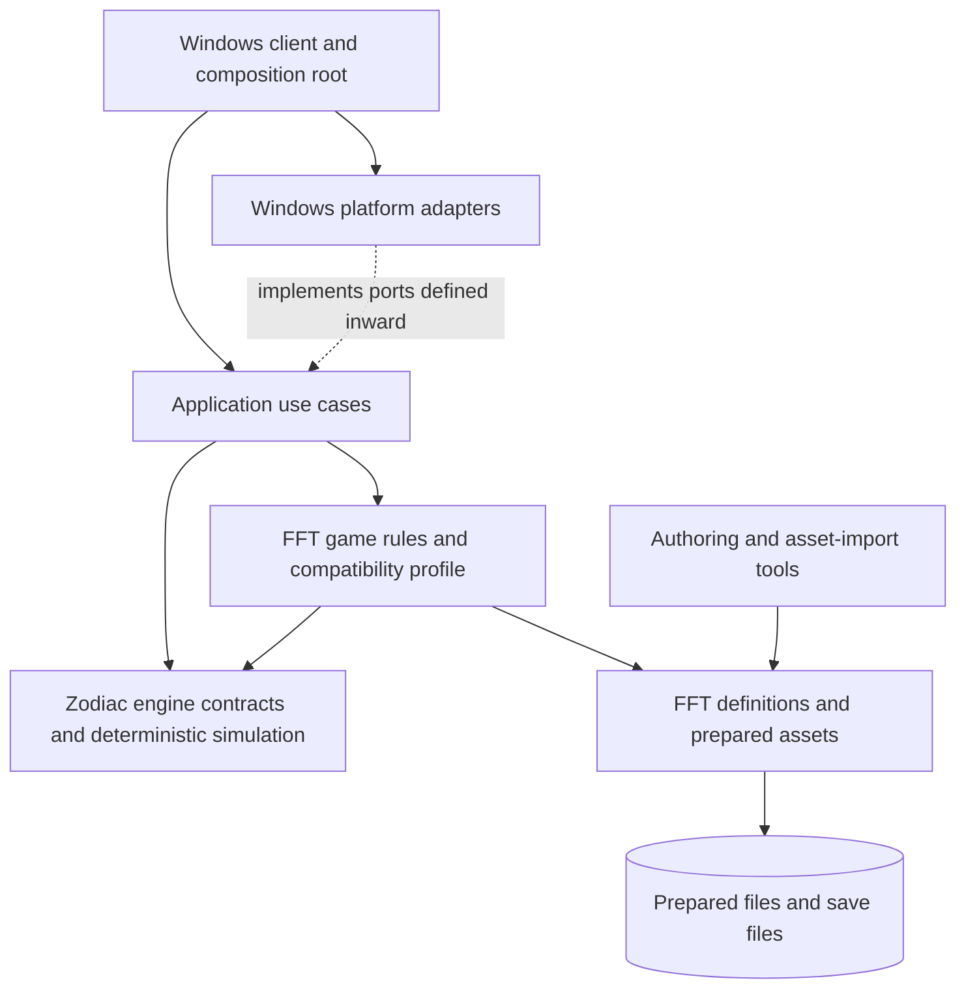

# Architecture overview

**Engine name:** Zodiac. Final Fantasy Tactics is a separate game that uses Zodiac as its engine. The agreed namespace roots are `Zodiac.Engine` for reusable engine logic and `Fft.*` for FFT-specific logic and tooling. FFT is not nested under the Zodiac namespace.

**Status:** Proposed architecture for review. The repository is still an early prototype; the diagrams below describe intended dependency boundaries, not a claim that these projects or services already exist.

## Goals

- Build Zodiac as a reusable C#/.NET tactical-game engine and run the North American PS1 release (`SCUS-94221`) as its first game/content layer.
- Keep compatibility behavior observable and testable, including quirks that affect play.
- Keep the original simulation deterministic and independent of presentation and operating-system services.
- Permit additional content and mechanics without imposing the original executable's fixed-size data limits.
- Use the C decompilation and locally prepared game files as development references and import sources, never as runtime dependencies.

## Current repository, verified

The [baseline coverage inventory](../coverage/README.md) records the current
supported subsets, source/evidence, tests, manual checkpoints and remaining gaps.
Its family-level entries are not a complete original record/encounter catalog.

- `Fft.Core` contains common identifiers/value types, map data types, a typed battle transition proof, and flat-grid movement policies (one prototype and one bounded terrain-cost slice).
- `Fft.Content` loads a versioned manifest and hash-verified loose files by logical asset ID,
  including the bounded prepared static sprite pose and frozen MAP003 scene/terrain. It references `Fft.Core`, without original-format parsers.
- `Fft.Content.Saves` owns the [bounded save DTO/codec and file adapter](../development/two-unit-battle-saves.md).
  Core restores snapshots against selected definitions without I/O; Client supplies
  a headless proof. The [ZOD-067 investigation](zod-067-campaign-save-state.md)
  maps original campaign fields/checkpoints and unsaved RNG lifecycles; ZOD-068/069
  select a bounded native checkpoint service and UI. Full campaign persistence remains separate.
- `Fft.Content.Events` validates/loads the [prepared synthetic conditional event](../development/prepared-scenario-event.md).
  AssetTool owns raw block inspection and the CLI assembly composes conversion.
  ZOD-065 projects into `Fft.Core.Events`: immutable normalized operations,
  instruction state/traces and pure bounded Step/Run execution. Content-to-Core
  dependencies remain one-way. [Execution limits](../behavior/conditional-event-execution.md)
  exclude EventEnd, scene lifecycle, timing, RNG and campaign integration.
  ZOD-071 adds a [separate explicit-tick wait profile](../behavior/timed-event-waits.md),
  composing private conditional validation/transitions with immutable timed state.
  Pending counts and caller-supplied ticks stay in FFT Core; host pacing stays outside it.
  [ZOD-066](zod-066-battle-start-event.md) traces original common BattleStart and
  names the missing camera/task/banner/lifecycle capabilities; it adds no playback.
  Original camera operand mutation must remain distinct from immutable definitions.
  [ZOD-072](zod-072-event-task-contract.md) selects a scene-owned task ledger and
  explicit barrier protocol, independently of interpreter lifetime. ZOD-073 now
  [implements the pure ledger/barrier proof](../behavior/scene-task-barriers.md)
  with stable instances/revisions, live scene-wide polling, explicit ordered facts
  and atomic failures. No workers or E5 interpreter integration exist yet (ZOD-074).
- `Fft.AssetTool` and `Fft.AssetTool.Cli` handle offline image inventory, extraction, narrow unit `.SPR`
  decoding, selected SHP/SEQ pose preparation and bounded GNS/mesh/indexed-texture conversion.
  The CLI composes the tools; no full animation interpreter exists.
- `Fft.Client` can load a prepared asset, run the deterministic synthetic two-unit battle headlessly,
  and open a MonoGame Windows view of its immutable starting snapshot or a fixed prepared
  MAP003/Chocobo scene. A separate local two-unit battle UI sends validated commands to
  the supported M1 scenario; the prepared scene remains static.
- Tests exist for the current projects, including pure client layout tests. The synthetic graphics
  host has separate Windows checks; no complete campaign runtime, audio adapter or campaign save system exists yet.

The architecture should evolve from this shape without splitting projects just for conceptual neatness. Add a new assembly when it creates a useful dependency boundary or an independently testable responsibility.

The completed [ZOD-001 ownership audit](zod-001-type-ownership.md) classifies every current Core type and recommends a bounds-only flat cardinal range calculation as the first engine slice, accessed through an FFT-owned facade. This is a documented extraction plan; the current assemblies and behavior remain unchanged.

Implementation update (2026-10-22): ZOD-007/008 now provide that bounds-only engine calculation and FFT facade integration. ZOD-009's [Relay sample](../../samples/Relay/README.md) runs the calculation with invented content, and a build target enforces the current engine project-reference boundary. These satisfy the bounded M0 engine demonstration; the broader architecture below remains a target, not implemented battle/campaign functionality.

Implementation update (2026-10-23): [ZOD-023](../behavior/two-unit-battle-scenario.md) completes bounded
M1 headless battle integration with an explicit synthetic first-KO objective, immutable restart/replay and
terminal-command rejection. FFT owns the lifecycle and rule composition, Content owns the invented setup/script,
and Client owns console output. Full FFT combat/campaign remain separate work.

Implementation update (2026-10-23): [ZOD-025](../development/windows-synthetic-host.md) adds the
MonoGame DesktopGL host in Client only. It renders a fixed synthetic snapshot without simulation
transitions or original assets. Live GPU/resize/close checks and headless layout tests passed;
mixed-DPI, physical input and prepared-map/sprite rendering remain bounded follow-up work.

Implementation update (2026-10-23): [ZOD-028](../development/prepared-sprite-pose.md) prepares the
source-traced Chocobo static pose as manifest-addressable metadata and RGBA data. Runtime Content
loads that representation without AssetTool/original-format dependencies. Prepared scene rendering
still awaits the selected map pipeline; deterministic simulation is unchanged.

Discovery update (2026-10-23): [ZOD-029](zod-029-map003-source-map.md) selects MAP003's day/dry
base scene and a four-cell alignment checkpoint. Its source terrain, indexed texture/palette,
geometry and frozen presentation metadata remain distinct preparation responsibilities for ZOD-030.
The existing bounded combat profile must not force source heights or flags to be rewritten.

Implementation update (2026-10-23): [ZOD-030](../development/prepared-map-slice.md) now prepares
that scene as manifest-addressable geometry, indexed texture/palette data, frozen presentation
metadata and two dense terrain layers. Content validates/loads it and projects normalized
terrain into Core without original-format parsing. Native heights and opaque provenance remain
intact. Client has a headless map-load check; ZOD-031 still owns prepared scene rendering.

Implementation update (2026-10-23): [ZOD-031](../development/prepared-scene.md) renders that
map and pose with a fixed authored camera, per-polygon palette selection, point-sampled
opaque cutout and modern depth. A source-derived terrain/quad alignment checkpoint and
synthetic tests cover transforms, strip coverage and piece order. Neutral lighting and
modern depth are explicit approximations; independent original comparison remains ZOD-026/033.
All rendering/resource lifetime and presentation timing stay in Client. Core/Engine,
simulation rules, prepared formats, project references and package locks are unchanged.

Implementation update (2026-10-23): [ZOD-032](../development/playable-battle.md) adds
mouse/keyboard selection, legal highlights, Move/Attack/Wait/Advance, status and restart
for the synthetic M1 scenario. Client owns input routing and a command journal; Core
accepts/rejects every attempted battle command and supplies immutable results. Highlight
probes discard pure result snapshots, preserving live RNG/state. Programmed Windows
play, headless script and journal replay agree, including after a resize. No new battle
rules, original-content combat integration or graphics/input dependency enters Core/Engine.

## Target dependency shape

### Product boundaries agreed with the owner

The intended product has three conceptual parts:

- **Zodiac Engine:** reusable game-development facilities, with deterministic simulation separated from presentation, input and authoring adapters.
- **FFT framework:** FFT rules, runtime systems, definition schemas, validators and supported script/action/condition execution. Existing `Fft.Core` and parts of `Fft.Content` implement this responsibility today.
- **FFT content:** original or authored jobs, abilities, equipment, maps, campaigns, event scripts, menu declarations, graphics and music, supplied through prepared content packages.

These are ownership boundaries, not a decision to create three assemblies or rename current namespaces. `Zodiac.Engine` remains the engine name/root; FFT remains independently rooted in `Fft.*`. Immutable definitions and schema code belong to the framework, while particular records belong to content. Running battle/campaign state is distinct from both. A new game can use Zodiac directly with its own rules, or use the FFT framework when it wants those mechanics.

Content management should eventually support adding, replacing, organizing, validating and previewing music, graphics, maps, scripted events and conditions. Packages associate records/assets by stable logical IDs and explicit dependencies; import provenance and original baseline content remain preserved. Original event decoding, deterministic interpretation, authoring UI and arbitrary custom executable behavior remain separate decisions (ZOD-040/043/047/048/049/050).

A menu entry can be declarative content selecting a framework-defined typed action and supported availability condition. Adding a title option for an existing StartCampaign action should require only content; a new operation also requires its handler. Package contributions need explicit target menus, stable entry IDs, deterministic placement and conflict/missing-reference diagnostics. This is a future contract investigated by ZOD-062, not an implemented menu or general scripting API.

The system has two product concerns with a one-way dependency: **Zodiac engine/framework** and **Final Fantasy Tactics game implementation**. The FFT layer depends on Zodiac; Zodiac must not depend on FFT types, assets, formulas, IDs, or campaign scripts. The current `Fft.*` projects have not yet been split along this boundary; this is a target architecture, not a description of today's assembly graph.

### Namespace and project naming convention

- Use `Zodiac.Engine` as the namespace and project name for reusable deterministic simulation contracts and behavior. Do not add a `.Core` segment unless a later, concrete assembly boundary justifies it.
- Keep `Fft.*` as the separate root for FFT-specific rules and compatibility behavior. Retain `Fft.Content` for content definitions and loading, `Fft.AssetTool` / `Fft.AssetTool.Cli` for offline import tools, and `Fft.Client` for the FFT host. `Fft.Core` remains the current home of FFT simulation and the mixed prototype pending bounded engine extraction.
- Namespaces communicate ownership, but project references enforce the boundary: FFT projects may reference `Zodiac.Engine`; Zodiac projects must not reference `Fft.*`.
- Assign a type to `Zodiac.Engine` only when its meaning and behavior are independent of FFT. FFT formulas, PS1 compatibility policies, job/ability/item definitions, game data identifiers, and FFT asset formats stay FFT-owned.
- Keep existing `Fft.*` projects and namespaces during exploration. Move types in small, reviewable steps after their ownership and contracts are understood; do not combine namespace migration with behavior changes.

Extract proven reusable responsibilities from the mixed `Fft.Core` prototype into `Zodiac.Engine` over time. FFT-owned projects retain their `Fft.*` names; there is no planned migration into a Zodiac game namespace. Shared asset-service abstractions may move into an engine-owned project only if a concrete engine use case requires them.

### Zodiac engine/framework responsibility

- Provide reusable deterministic tactical simulation primitives and contracts: map/grid topology, spatial positions, runtime-state boundaries, commands/transitions, turn-scheduling hooks, action/targeting abstractions, movement/range policy contracts, status/effect application points, deterministic random-state interfaces, simulation events, and replay/logging seams.
- Keep behavior neutral where different games reasonably vary. Rules should be selected or supplied through explicit policies/profiles rather than FFT-specific branches in the engine.
- Provide content package and asset-service abstractions without embedding FFT identifiers, binary layouts, jobs, abilities, formulas, or copyrighted assets.
- Keep rendering, input, audio, storage, and operating-system specifics in adapters or host applications.
- Aim for a small tactical engine, not an all-purpose framework. Add abstractions when another concrete use case demonstrates value.

### FFT game/content responsibility

- Own FFT concepts and compatibility behavior: jobs and JP, abilities/skill sets, items/equipment, statuses, FFT formula implementations, progression, CT/turn semantics, map terrain meanings, encounters, battle/campaign/event scripts, localization, and PS1-specific asset conversion/selection.
- Translate validated FFT definitions and imported source data into Zodiac runtime contracts. Preserve exact compatibility semantics in an explicit PS1 profile; isolate later Lion War/WotL additions in a separate profile/content set.
- Keep a trace from important FFT rules/data fields to the pinned decomp source and, where available, original/emulator observations and regression fixtures.
- Keep the asset importer FFT-aware. The engine consumes prepared logical assets or game-provided rendering data, never raw BIN sectors.

This boundary is conceptual first. `Fft.Core` currently contains FFT-flavored map and movement models and is not yet a clean reusable engine package. Generalize or move a type only when its engine-level contract is understood and an FFT adapter can preserve behavior. Keep project/namespace renames separate from behavior changes.

`Fft.Core` is the current home for FFT simulation; the proven reusable bounds-only slice lives in
`Zodiac.Engine`. Further assembly splits should follow demonstrated seams. An application project
remains a future option when concrete use cases require it. [ADR 0005](../adr/0005-windows-rendering-and-input-stack.md)
selects MonoGame DesktopGL, integrated by ZOD-025 in Client only. See the
[host note](../development/windows-synthetic-host.md) for executed checks and remaining DPI/device/input limits.

The dependency rule is inward: simulation code must not reference `Fft.Client`, graphics/audio/input packages, operating-system APIs, the BIN, or the C reference. Platform adapters implement interfaces owned by an inward-facing layer. The client is the composition root that chooses implementations and connects input, use cases, content, and presentation.

## Responsibilities and contracts

### Zodiac engine domain and simulation

- Own reusable stable/runtime identity contracts, simulation state/transition abstractions, deterministic random state, generic tactical policies, and simulation events. It must not own FFT job definitions, formula tables, story state, campaign data, or PS1 binary layouts.
- Represent play as explicit inputs to a transition: current state plus a command and RNG state produce a new state, result/events, and updated RNG state.
- Avoid file I/O, wall-clock reads, global randomness, rendering, audio, and direct input polling.
- Use collections sized by content and explicit validation/resource budgets. Preserve original limits only when they affect compatibility or are an intentional safety limit.
- Record arithmetic width, rounding, RNG draw order, and update ordering where they affect observed behavior.

Commands express requested actions; the simulation validates them. Events describe accepted state changes for presentation, logs, and tests. They are not a second authority that can mutate simulation state. Start with simple typed C# models; do not introduce a generic ECS, event sourcing framework, or plugin bus until a concrete need appears.

### Content definitions and runtime state

- Keep immutable, validated game-specific definitions (FFT jobs, abilities, items, maps, encounters, campaign data) separate from mutable runtime instances (unit HP/MP, status, equipment, turn state, and story flags). These definitions belong to the FFT game/content layer, not Zodiac's generic engine package.
- Give definitions stable, namespaced IDs. Validate cross-references and schema versions when loading a package rather than failing during a battle.
- Layer original-compatible content and additions explicitly. Do not overwrite or silently alter baseline definitions when loading an extension pack.
- Keep save data as a versioned persistence contract made from stable IDs and explicit state DTOs, not a serialized in-memory object graph. Define migrations when save format becomes necessary.

### Asset import and runtime access

- `Fft.AssetTool` is an offline import/validation tool. It may inspect the user's local BIN and emit prepared files/manifests under ignored `/scratch/` during development.
- The running client loads prepared files by logical asset ID through `Fft.Content`; it does not open the BIN or invoke the extractor.
- Keep source assets, converted outputs, and manifests reproducible. Test parsers/decoders with synthetic inputs and source-traced vectors; keep copyrighted game-derived bytes local.
- Rendering consumes decoded content through a narrow asset/content boundary. It should not contain gameplay rules or ISO parsing.

### Application, platform, and presentation

- Application use cases coordinate requests such as starting a battle, issuing a simulation command, loading campaign data, and saving. They do not implement game rules or draw pixels.
- Platform adapters own Windows windowing, graphics, audio, controller/keyboard input, file locations, and OS timing. MonoGame DesktopGL now hosts the synthetic Windows view; broader adapters remain future work.
- Presentation translates input into application commands and turns state/events into view models or render submissions. It never writes battle state directly.
- Keep the simulation executable headlessly in tests and command-line tools.

The owner also wants native Windows presentation/input enhancements investigated: widescreen, higher-resolution rendering/textures, keyboard/mouse and controller support. These are future requirements (ZOD-059/060/061/063), with stack capabilities considered during ZOD-024. The higher-resolution video goal means rendering the game view at a selectable resolution, for example 1920 x 1080 on a landscape display (the owner's 1080 x 1920 example is assumed to have dimensions reversed). It does not request movie replacement/upscaling. Widescreen camera/viewport and UI layout, internal rendering resolution and source/replacement texture detail remain separate concerns.

Higher-resolution mode should rasterize supported scene geometry at the selected internal resolution rather than only enlarge a completed low-resolution frame. Original sprites/textures retain their source detail and use an explicit sampling policy; replacement artwork is a separate content capability and is not a prerequisite for higher-resolution rendering. Resolution and aspect ratio are independent settings: an original-aspect presentation may use letterboxing/pillarboxing, while widescreen requires the camera/UI work in ZOD-059.

Presentation options should preserve gameplay outcomes for the same logical commands and seed. Distinguish the original presentation/reference profile from explicitly selected enhancements and replacement asset packs. Device adapters translate keyboard, mouse and controller operations into the same application commands; remapping, prompts and navigation belong outside deterministic simulation. Higher output resolution alone does not create new source texture or movie detail.

The owner also intends to rework the UI itself for wider aspect ratios and native keyboard/mouse use.
ZOD-059 and ZOD-061 should coordinate screen composition, menu/HUD placement, information density,
direct mouse selection, keyboard focus/shortcuts and prompts. Concrete layouts and interaction choices
come after representative battle/menu workflows exist. Keep this an explicit Windows presentation option
alongside the original reference presentation; UI changes consume the same validated gameplay commands
and remain outside deterministic simulation. This records future design intent, not implementation now.

### Extensions and The Lion War

- Start extensions with validated, versioned declarative content packages and a typed set of supported actions/effects.
- Keep the PS1-compatible campaign/profile as the baseline. Enable extra jobs, items, characters, maps, encounters, campaigns, or mechanics through explicit profiles/package layers.
- Treat The Lion War as a distinct compatibility/content profile after selecting its exact variant and feature scope. Preserve provenance and identify intentional deviations from the PS1 baseline.
- Defer arbitrary managed-assembly plugins and general-purpose scripting. If data and typed effects cannot express required campaign behavior, design a deterministic sandbox with versioned APIs and explicit permissions.

## Behavioral validation

Use several independent kinds of evidence; none alone proves full equivalence:

1. Unit tests for arithmetic, edge cases, and source-traced rule vectors.
2. Deterministic replay tests: same initial state, commands, and random seed produce identical state and event traces.
3. Scenario regressions with recorded preconditions, inputs, expected transitions, and reference decomp commit.
4. Differential checks against executable source-derived or emulator-observed outputs when a suitable oracle exists.
5. Separate visual checks with fixed game state/frame captures, image diffs, and manual review. Do not treat screenshot similarity as a substitute for simulation tests.
6. Content validation and decode tests that do not require the BIN; real-asset integration checks remain local under `/scratch/`.

Tests should state whether the expected value comes from direct source tracing, an executing oracle, an emulator capture, or an assumption. The decomp's machine-code matching checks establish a different property than the C# behavior tests.

The initial state/command/event contract and its explicitly simplified movement policy are recorded in [`../battle-transition-poc.md`](../battle-transition-poc.md).

The terrain and unit movement input model, including its source mapping and unimplemented pieces, is documented in [`../behavior/movement-inputs.md`](../behavior/movement-inputs.md).

## Deferred decisions and open questions

- Production audio/input coverage and Windows deployment format beyond the synthetic MonoGame host.
- Whether turn/campaign runtime eventually warrants separate `Fft.Simulation` and `Fft.Application` assemblies.
- Complete campaign save schema, broader content/package migration policy, and backup behavior.
  ZOD-035 selects only the bounded two-unit contract and synthetic migration above.
- Package archive format, signing/trust policy, conflict resolution, and hot reload needs.
- Script language and sandbox policy, if declarative mechanics prove insufficient.
- Exact The Lion War variant, revision, imported features, and intentional rule changes.
- Which original/emulator observations are available for validating behavior beyond static decompilation.

Resolve these only when a milestone has concrete requirements that depend on them.

Discovery update (2026-10-23): [ZOD-040](zod-040-event-script-investigation.md)
separates event/scenario/location/presentation script families and recommends
offline decoding followed by a pure FFT-owned conditional-event executor.
ZOD-064/065/066 own the bounded follow-ups. No FFT opcode/variable bank enters
Zodiac, and no event interpreter is implemented by this investigation.
ZOD-067 traces logical campaign save fields and original save availability before
expanding ZOD-035's snapshot contract or adding the Windows Save/Load interface.
